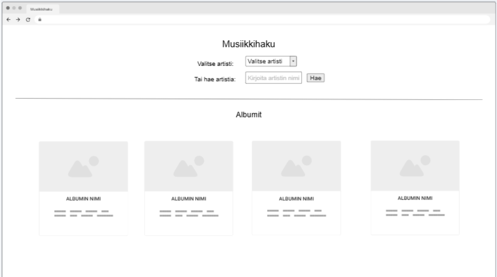
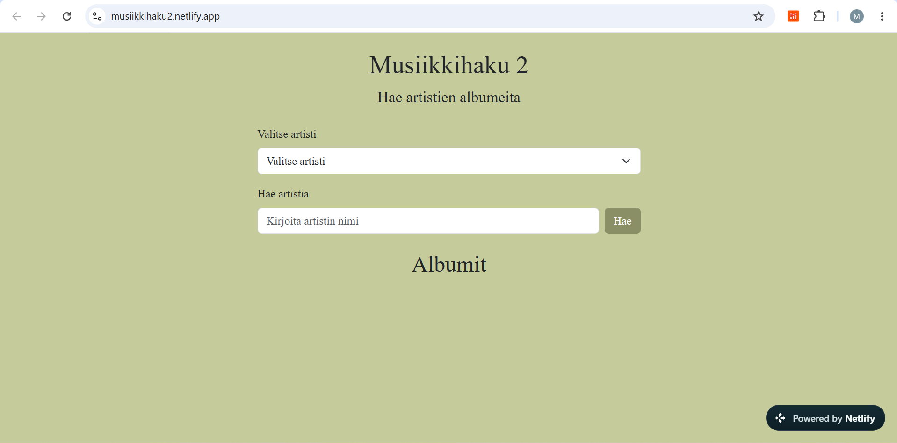
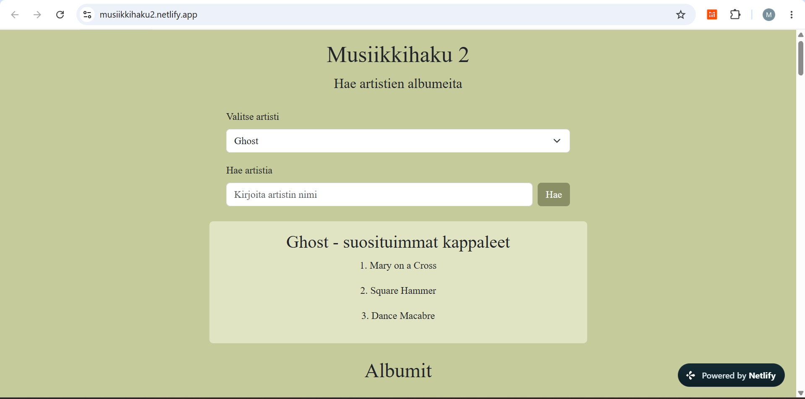
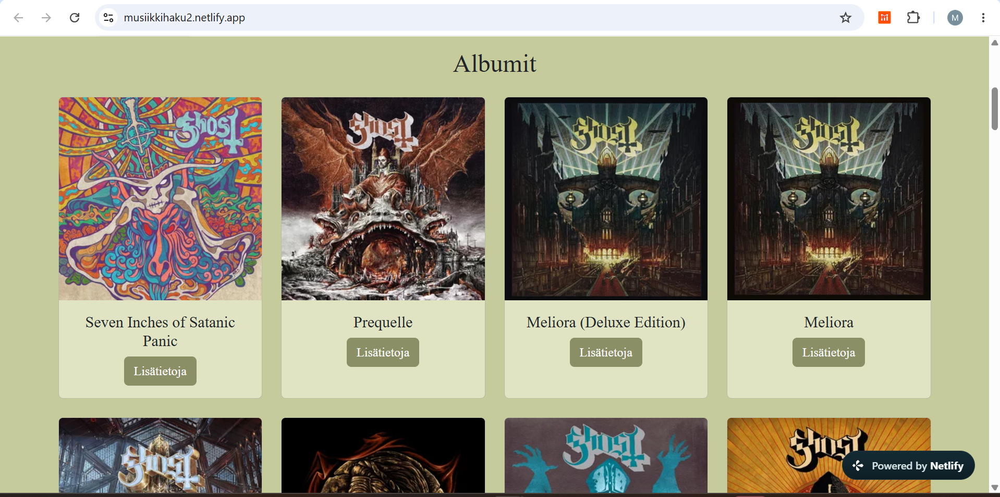

# Musiikkihaku 2

**Tekijä:** Mikaela Grundström

## Projektisuunnitelma

### Projektin idea

Musiikkihaku 2 on jQueryä ja Bootstrapia hyödyntävä sovellus, jonka avulla käyttäjä voi etsiä artistien albumeita Last.fm-palvelun kautta. Käyttäjä voi valita artistin sivulla olevasta listasta tai itse hakukentän avulla. Sovellus näyttää myös artistin top 3 - kappaletta. Sovellus on tarkoitettu kenelle tahansa, joka haluaa käydä läpi jonkun artistin albumeita.

### Suunnitellut toiminnot

- Artistin valinta alasvetovalikosta
- Artistin haku hakukentällä
- Albumien kuvien ja nimen näyttäminen
- Artistin suosituimpien kappaleiden näyttäminen
- Linkki albumin lisätietoihin

### Rautalankamalli / luonnos

## Verkkolinkit

- **Julkaistu sovellus:** (https://musiikkihaku2.netlify.app/)
- **GitHub-repositorio:** (https://github.com/mikaelalinnea/musiikkihaku2)
- **Projektin videoesittely:** (https://youtu.be/IOABl-mLeYc)

## Tietoja sovelluksesta

**Musiikkihaku 2** on verkkosovellus, joka hyödyntää Last.fm APIa eri musiikkitietojen hakemiseen. Käyttäjä voi etsiä artisteja, jolloin sivulla näkyy sen artistin albumit sekä suosituimmat kappaleet. Sivulta pääsee myös jokaisen albumin kohdalta linkin kautta katsomaan lisätietoja albumista, kuten kappaleet. Sovellus hyödyntää Netlify API-avaimen suojaamiseen, Bootstrapia käyttöliittymän toteuttamiseen ja jQueryä tapahtumankäsittelyyn ja tietojen hakemiseen.

## Teknologiat

- HTML – sivun rakenne
- CSS – ulkoasu ja asettelu
- JavaScript – toiminnallisuus
- jQuery - AJAX-kutsut, DOM-skriptaus, tapahtumankäsittely
- Bootstrap - responsiivinen ulkoasu ja käyttöliittymän komponentit
- Last.fm API - artisti ja albumitiedot
- Netlify - sovelluksen julkaisu, API-avaimen suojaaminen

## Sovelluksen käyttö

1. Avaa julkaistu sovellus yllä olevasta linkistä.
2. Valitse artisti alasvetovalikosta tai kirjoita artistin nimi hakukenttään.
3. Hae artisti listasta tai paina Hae.
4. Sovellus näyttää artistin albumit sekä kolme suosituinta kappaletta.
5. Lisätietoja-linkistä pääsee Last.fm albumisivulle.

## Sovelluksen käynnistäminen paikallisesti

1. Kloonaa tai lataa tämä repositorio omalle koneellesi.
2. Avaa projektikansio.
3. Lisää oma Last.fm API-avain Netilfyn ympäristömuuttujiin.
4. Käynnistä projekti Netlify Dev-ympäristössä.
5. Avaa sovellus selaimessa.

## Kuvakaappaukset

## Tunnetut virheet / puutteet

 **Ei tunnettuja virheitä.**

## Oma arvio ja oppimisen reflektointi

Pohdi työtäsi ja oppimisprosessiasi.

- Onnistuin toteuttamaan toimivan verkkosovelluksen, joka hyödyntää Last.fm APIa. Sain toimimaan että käyttäjä pystyy hakea artisteja alasvetovalikosta sekä hakukentän avulla. Sovellus näyttää albumit, albumikuvat sekä artistin suosituimmat kappaleet.
- Haastavinta oli AJAX-kutsujen toteuttaminen ja datan käsittely.
- Jos olisi enemmän aikaa, kehittäisin käyttöliittymää enemmän.
- Projektin aikana opin käyttämään jQueryä tapahtumankäsittelyyn, AJAX-kutsuihin ja DOM-skriptaukseen. Opin myös paremmin hyödyntämään Bootstrapia.
- Haluaisin oppia lisää JavaScript-kirjastoista ja  API-rajapinnoista ja niiden käytöstä.
- Oma arvio projektista: **8/10 pistettä**

## Lähteet ja kiitokset

- Kurssimateriaali & aikaisemmat workshopit.
- [Last.fm/api](https://www.last.fm/api)
- [jQuery](https://jquery.com/)
- [W3schools-jQuery](https://www.w3schools.com/jquery/default.asp)
- [Bootstrap](https://getbootstrap.com/docs/5.3/getting-started/introduction/)

- Käytetty tekoälytyökalu: Microsoft Copilot
  - Tekoälyä on käytetty koodin virheiden etsimiseen jos jokin toiminto ei toiminut oikein sekä koodin siistimiseen.

  ## Lisenssi

Tämä projekti on lisensoitu MIT-lisenssillä.